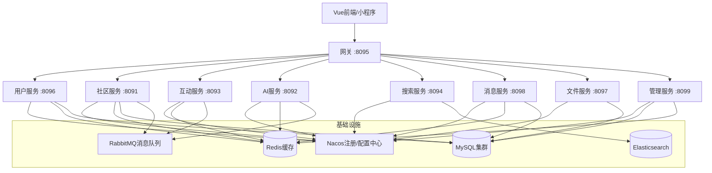

## 产品概述

基于 Spring Cloud Alibaba + Vue 3 + 微信小程序 + Spring AI 的微服务社区论坛交流平台，从零完整实现所有后端微服务（10个模块）、Vue前端管理后台及用户端、微信小程序端，以及安全管控体系。

## 核心功能

### 后端微服务（三层架构：Controller/Service/Mapper）

- **用户服务(8096)**: 注册/登录(JWT双令牌)、个人信息管理、关注/粉丝、签到积分、用户拉黑、在线状态、设备管理
- **社区服务(8091)**: 帖子CRUD/置顶/精华/匿名/草稿、多级评论回复/楼层号、板块管理、话题管理、投票系统(单选/多选/匿名)、专栏管理、举报管理
- **互动服务(8093)**: 点赞(帖子/评论)、收藏/取消收藏、收藏夹管理，Redisson分布式锁+MQ异步落库
- **AI服务(8092)**: 对话聊天、写作助手、内容总结、文章润色、违规检测、AI推荐、话题生成、用户兴趣标签
- **搜索服务(8094)**: Elasticsearch全文搜索(IK分词)、热搜榜、搜索历史
- **消息服务(8098)**: 系统通知、互动通知(点赞/评论/关注)、私信聊天、WebSocket推送
- **文件服务(8097)**: 文件上传/下载/访问、MIME类型识别
- **管理服务(8099)**: 管理员登录、用户管理、帖子/评论管理、举报处理、敏感词管理、系统配置、操作日志、数据统计
- **网关服务(8095)**: 统一路由、JWT认证过滤、跨域CORS、限流、IP黑名单
- **公共模块**: 统一Result返回、全局异常处理、分页封装、Redis工具、WebSocket、敏感词过滤器、操作日志AOP

### Vue前端（Element Plus）

- **用户端**: 首页(推荐/最新/热榜)、帖子列表/详情/发布(Markdown)、评论系统、板块/话题、个人中心、消息通知、私信、搜索、AI助手
- **管理端**: 数据仪表盘、用户管理、内容审核、举报处理、敏感词管理、系统配置

### 微信小程序（原生框架）

- 首页、帖子列表/详情/发布、评论、消息通知、私信、个人中心、搜索

## 技术栈

### 后端

- **基础框架**: Spring Boot 3.3.5 + Java 17
- **微服务**: Spring Cloud Alibaba 2023.0.1.0 + Spring Cloud 2023.0.1
- **注册/配置中心**: Nacos 2.x
- **API网关**: Spring Cloud Gateway
- **服务调用**: OpenFeign
- **持久层**: MyBatis-Plus 3.5.7
- **数据库**: MySQL 8.0 (9个数据库)
- **缓存/分布式锁**: Redis + Redisson 3.35.0
- **消息队列**: RabbitMQ
- **搜索**: Elasticsearch 7.17 + IK分词
- **AI**: Spring AI 1.0.0-M5 (OpenAI兼容接口)
- **认证**: JJWT 0.12.6 (JWT双令牌)
- **工具**: Hutool 5.8.32, Lombok, MapStruct

### 前端Vue

- **框架**: Vue 3 + Vite 5 + TypeScript
- **UI库**: Element Plus
- **状态管理**: Pinia
- **路由**: Vue Router 4
- **HTTP**: Axios
- **Markdown编辑器**: md-editor-v3
- **图表**: ECharts

### 微信小程序

- **框架**: 原生微信小程序 (WXML/WXSS/JS)

## 系统架构



## 数据库分库策略

| 数据库 | 对应服务 | 核心表 |
| --- | --- | --- |
| community_user | 用户服务 | user, user_follow, user_block, user_checkin, user_device, points_record, system_notice, hot_post |
| community_content | 社区服务 | post, comment, post_draft, post_report, section, topic, vote, vote_option, vote_record, post_topic, user_topic, column_info, column_post, user_column |
| community_interact | 互动服务 | like_record, collect, collect_folder |
| community_ai | AI服务 | ai_chat, ai_check, ai_recommend, ai_summary, ai_task, ai_topic, user_interest |
| community_search | 搜索服务 | search_hot_keyword |
| community_message | 消息服务 | notice, chat_msg |
| community_file | 文件服务 | file_record |
| community_admin | 管理服务 | sys_admin, sys_admin_log, sys_config |
| community_security | 安全模块(community-common) | ip_blacklist, operation_log, rate_limit_record, report, sensitive_word, sys_config, text_review |


## 实现策略

### 分阶段交付

由于项目规模巨大（10个后端微服务 + Vue前端 + 微信小程序），采用分阶段构建，每阶段交付可运行的完整功能：

**阶段1 - 基础骨架**: 根POM + community-common公共模块 + 网关 + 用户服务 + Vue前端骨架
**阶段2 - 核心业务**: 社区服务(帖子/评论/板块) + 互动服务(点赞/收藏) + Vue帖子相关页面
**阶段3 - 消息搜索**: 消息服务 + 搜索服务 + 文件服务 + Vue消息搜索页面
**阶段4 - AI与管理**: AI服务 + 管理服务 + Vue管理后台
**阶段5 - 小程序**: 微信小程序完整实现

### 关键技术决策

1. **Spring Cloud Alibaba版本**: 2023.0.1.0，兼容Spring Boot 3.3.x
2. **网关认证**: JwtAuthFilter在网关层统一验证，业务服务通过Feign传递用户信息
3. **双令牌**: AccessToken(30min) + RefreshToken(7天)，Redis存储黑名单和刷新令牌
4. **互动异步化**: 点赞/收藏先写Redis，通过MQ异步落库，Redisson防重
5. **ES搜索**: 使用@Document注解定义索引，RestHighLevelClient操作ES
6. **AI集成**: Spring AI OpenAI兼容接口，支持doubao等国产模型
7. **跨服务调用**: OpenFeign + fallback，避免循环依赖

## 目录结构

```
community/
├── pom.xml                          # [MODIFY] 改造为多模块父POM
├── database/                        # 数据库SQL(已有)
├── community-common/                # [NEW] 公共模块
│   └── src/main/java/com/community/common/
│       ├── config/                  # RedisConfig, RedissonConfig, WebSocketConfig, MyBatisPlusConfig
│       ├── constant/                # RedisKeyConstant, MQConstant, CommonConstant
│       ├── enums/                   # ResultCode, NoticeType, etc.
│       ├── exception/               # BusinessException, GlobalExceptionHandler
│       ├── feign/                   # Feign配置, fallback工厂, 用户信息传递
│       ├── result/                  # Result, PageResult
│       ├── util/                    # JwtUtil, RedisUtil, SensitiveWordFilter, WebsocketUtil
│       ├── security/                # SecurityConfig(通用)
│       ├── aop/                     # OperationLogAspect, RateLimitAspect
│       ├── dto/                     # UserDTO, PageDTO(跨服务传输)
│       └── websocket/               # WebSocketServer, WebSocketHandler
├── community-gateway/               # [NEW] 网关服务 :8095
│   └── src/main/java/com/community/gateway/
│       ├── filter/                  # JwtAuthFilter, RateLimitFilter, IpBlacklistFilter
│       ├── config/                  # GatewayConfig, CorsConfig
│       └── handler/                 # CustomErrorWebExceptionHandler
├── community-user/                  # [NEW] 用户服务 :8096
│   └── src/main/java/com/community/user/
│       ├── controller/              # UserController, FollowController, CheckinController
│       ├── service/                 # UserService, FollowService, CheckinService, PointsService
│       ├── mapper/                  # UserMapper, UserFollowMapper, UserBlockMapper, UserCheckinMapper, PointsRecordMapper
│       ├── entity/                  # User, UserFollow, UserBlock, UserCheckin, PointsRecord, SystemNotice, HotPost
│       ├── dto/                     # LoginDTO, RegisterDTO, UserUpdateDTO, UserInfoVO
│       ├── config/                  # SecurityConfig, FeignConfig
│       └── interceptor/             # JwtInterceptor
├── community-community/             # [NEW] 社区服务 :8091
│   └── src/main/java/com/community/community/
│       ├── controller/              # PostController, CommentController, SectionController, TopicController, VoteController, ColumnController, ReportController
│       ├── service/                 # PostService, CommentService, SectionService, TopicService, VoteService, ColumnService, ReportService, DraftService, HotPostService
│       ├── mapper/                  # PostMapper, CommentMapper, SectionMapper, TopicMapper, VoteMapper, VoteOptionMapper, VoteRecordMapper, PostDraftMapper, PostReportMapper, ColumnInfoMapper, ColumnPostMapper, UserTopicMapper, PostTopicMapper, UserColumnMapper
│       ├── entity/                  # Post, Comment, Section, Topic, Vote, VoteOption, VoteRecord, PostDraft, PostReport, ColumnInfo, ColumnPost, PostTopic, UserTopic, UserColumn
│       ├── dto/                     # PostDTO, PostDetailVO, CommentDTO, CommentVO, SectionVO
│       ├── config/                  # SecurityConfig
│       ├── mq/                      # MQ消费者(接收互动事件更新计数)
│       └── task/                    # HotPostScheduleTask(热榜计算)
├── community-interact/              # [NEW] 互动服务 :8093
│   └── src/main/java/com/community/interact/
│       ├── controller/              # LikeController, CollectController, CollectFolderController
│       ├── service/                 # LikeService, CollectService, CollectFolderService
│       ├── mapper/                  # LikeRecordMapper, CollectMapper, CollectFolderMapper
│       ├── entity/                  # LikeRecord, Collect, CollectFolder
│       ├── mq/                      # MQ生产者(发消息通知业务服务)
│       └── config/                  # SecurityConfig, RedissonConfig
├── community-ai/                    # [NEW] AI服务 :8092
│   └── src/main/java/com/community/ai/
│       ├── controller/              # AiChatController, AiWriteController, AiAdminController
│       ├── service/                 # AiChatService, AiWriteService, AiReviewService, AiRecommendService, AiTopicService, AiSummaryService, UserInterestService
│       ├── mapper/                  # AiChatMapper, AiCheckMapper, AiRecommendMapper, AiSummaryMapper, AiTaskMapper, AiTopicMapper, UserInterestMapper
│       ├── entity/                  # AiChat, AiCheck, AiRecommend, AiSummary, AiTask, AiTopic, UserInterest
│       ├── dto/                     # ChatRequest, ChatResponse, WriteRequest
│       ├── mq/                      # AI任务消费者
│       └── config/                  # SecurityConfig, AiConfig
├── community-search/                # [NEW] 搜索服务 :8094
│   └── src/main/java/com/community/search/
│       ├── controller/              # SearchController, HotKeywordController
│       ├── service/                 # SearchService, HotKeywordService
│       ├── document/                # PostDocument(ES索引定义)
│       ├── repository/              # PostSearchRepository
│       ├── mapper/                  # SearchHotKeywordMapper
│       ├── entity/                  # SearchHotKeyword
│       ├── mq/                      # 搜索数据同步消费者
│       └── config/                  # ElasticsearchConfig, SecurityConfig
├── community-message/               # [NEW] 消息服务 :8098
│   └── src/main/java/com/community/message/
│       ├── controller/              # NoticeController, ChatMsgController
│       ├── service/                 # NoticeService, ChatMsgService
│       ├── mapper/                  # NoticeMapper, ChatMsgMapper
│       ├── entity/                  # Notice, ChatMsg
│       ├── mq/                      # 通知消息消费者(点赞/评论/关注/收藏事件)
│       └── config/                  # SecurityConfig
├── community-file/                  # [NEW] 文件服务 :8097
│   └── src/main/java/com/community/file/
│       ├── controller/              # FileController
│       ├── service/                 # FileService
│       ├── mapper/                  # FileRecordMapper
│       ├── entity/                  # FileRecord
│       └── config/                  # SecurityConfig, StorageConfig
├── community-admin/                 # [NEW] 管理服务 :8099
│   └── src/main/java/com/community/admin/
│       ├── controller/              # AdminAuthController, UserManageController, PostManageController, CommentManageController, ReportManageController, SensitiveWordController, SystemConfigController, DashboardController
│       ├── service/                 # SysAdminService, UserManageService, ContentManageService, ReportService, SensitiveWordService, SystemConfigService, DashboardService
│       ├── mapper/                  # SysAdminMapper, SysAdminLogMapper, SysConfigMapper, IpBlacklistMapper, OperationLogMapper, SensitiveWordMapper, TextReviewMapper, ReportMapper, RateLimitRecordMapper
│       ├── entity/                  # SysAdmin, SysAdminLog, SysConfig(管理端), IpBlacklist, OperationLog, SensitiveWord, TextReview, Report, RateLimitRecord
│       ├── dto/                     # AdminLoginDTO, DashboardVO
│       ├── feign/                   # UserFeign, CommunityFeign, InteractFeign, MessageFeign
│       └── config/                  # SecurityConfig
├── community-vue/                   # [NEW] Vue前端项目 :3000
│   ├── package.json
│   ├── vite.config.ts
│   ├── tsconfig.json
│   ├── index.html
│   └── src/
│       ├── main.ts
│       ├── App.vue
│       ├── router/index.ts          # 路由配置
│       ├── store/                   # Pinia状态管理
│       ├── api/                     # API接口封装
│       ├── utils/                   # 工具函数(request, auth, format)
│       ├── layouts/                 # 布局组件(用户端/管理端)
│       ├── views/user/              # 用户端页面
│       │   ├── home/                # 首页(推荐/最新/热榜)
│       │   ├── post/                # 帖子(列表/详情/发布/编辑)
│       │   ├── comment/             # 评论组件
│       │   ├── section/             # 板块页
│       │   ├── topic/               # 话题页
│       │   ├── search/              # 搜索页
│       │   ├── message/             # 消息/通知/私信
│       │   ├── profile/             # 个人中心/编辑资料
│       │   ├── user/                # 用户主页/关注/粉丝
│       │   └── ai/                  # AI助手
│       ├── views/admin/             # 管理后台页面
│       │   ├── dashboard/           # 数据仪表盘
│       │   ├── user/                # 用户管理
│       │   ├── content/             # 内容管理(帖子/评论审核)
│       │   ├── report/              # 举报处理
│       │   ├── sensitive/           # 敏感词管理
│       │   └── config/              # 系统配置
│       └── components/              # 通用组件
└── community-wx/                    # [NEW] 微信小程序
    ├── app.js / app.json / app.wxss
    ├── project.config.json
    ├── sitemap.json
    ├── utils/                       # 工具函数(request, auth, util)
    ├── components/                  # 自定义组件(帖子卡片/评论/导航栏)
    ├── pages/
    │   ├── index/                   # 首页(推荐/关注/板块)
    │   ├── post/                    # 帖子列表/详情/发布
    │   ├── comment/                 # 评论页
    │   ├── section/                 # 板块列表
    │   ├── topic/                   # 话题列表
    │   ├── search/                  # 搜索页
    │   ├── message/                 # 消息/通知/私信
    │   ├── profile/                 # 个人中心
    │   ├── user/                    # 其他用户主页
    │   └── login/                   # 登录页
    └── static/                      # 静态资源
```

## 实施要点

1. **POM管理**: 父POM统一管理所有版本号，子模块通过parent继承，避免版本冲突
2. **Nacos配置**: 每个服务在bootstrap.yml中配置Nacos连接，共享配置放Nacos
3. **Feign调用**: 定义在consumer端，fallback降级处理，通过Header传递userId/token
4. **MQ事件**: 互动事件(点赞/评论/关注/收藏) -> MQ -> 各服务异步处理
5. **ES索引**: 搜索服务独立维护ES索引，社区服务通过MQ同步帖子数据到ES
6. **安全**: 敏感词过滤在community-common中AOP拦截，限流在网关+业务双重控制
7. **前后端联调**: Vue通过vite proxy代理到网关8095，API前缀按服务名路由

## 设计风格

采用现代科技社区风格，以蓝白为主色调，搭配渐变和圆角设计，营造专业而活跃的社区氛围。

## 页面规划

### 用户端页面

1. **首页**: 顶部搜索栏 + 导航Tab(推荐/最新/热榜/板块) + 帖子瀑布流卡片(封面图+标题+摘要+作者头像+点赞评论数) + 右侧热门话题/活跃用户侧边栏
2. **帖子详情页**: 帖子完整内容(Markdown渲染) + 作者信息栏 + 点赞/收藏/分享操作栏 + 多级评论列表(楼层号/回复) + 评论输入框
3. **帖子发布页**: Markdown编辑器(md-editor-v3) + 板块选择 + 话题标签选择 + 图片上传 + 投票创建(可选)
4. **个人中心**: 头像/昵称/签名信息卡 + 数据统计(帖子/粉丝/关注/积分) + Tab切换(我的帖子/收藏/点赞历史/签到记录)
5. **AI助手页**: 左侧会话历史列表 + 右侧聊天窗口(消息气泡) + 功能选择(写作/润色/总结)

### 管理后台页面

6. **数据仪表盘**: 统计卡片(用户数/帖子数/评论数/今日活跃) + ECharts折线图(趋势) + 最新举报/待审核列表

## Agent Extensions

- **code-explorer**
- Purpose: 在创建各模块时探索已有代码结构和依赖关系，确保模块间引用正确
- Expected outcome: 准确的文件路径、正确的依赖引用、一致的包命名规范